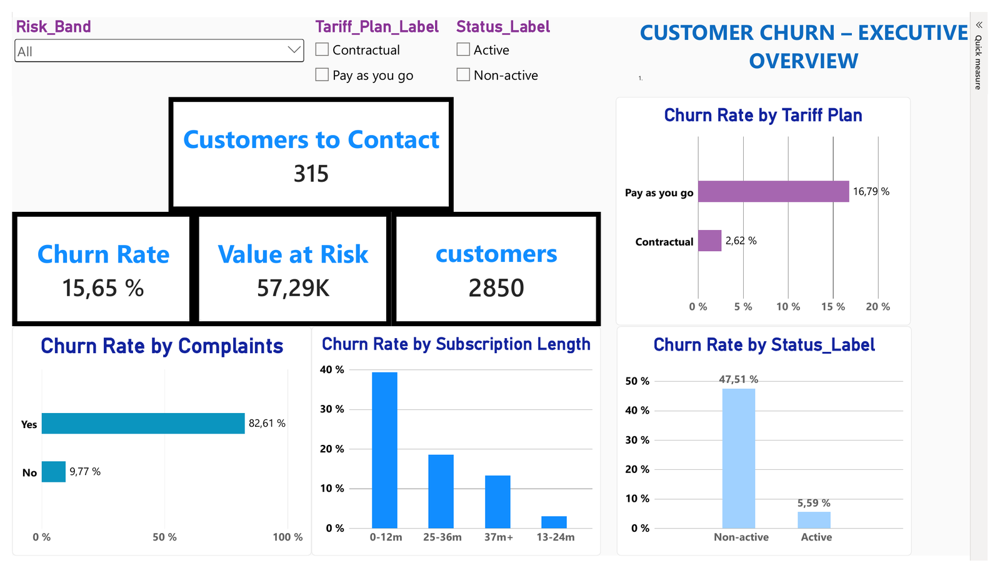
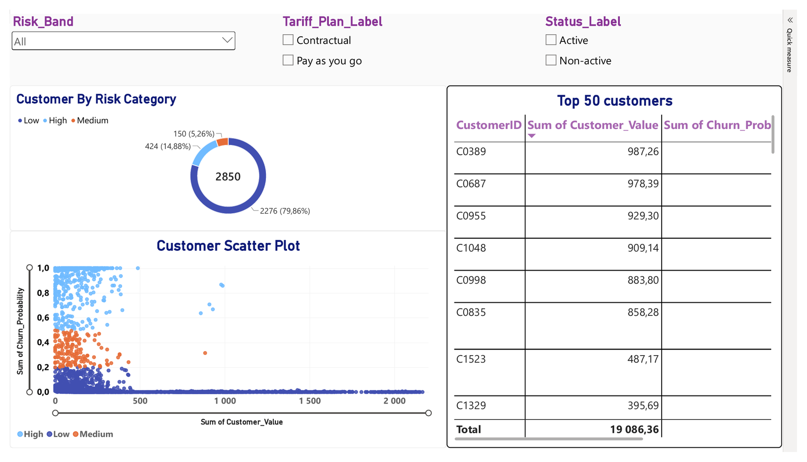
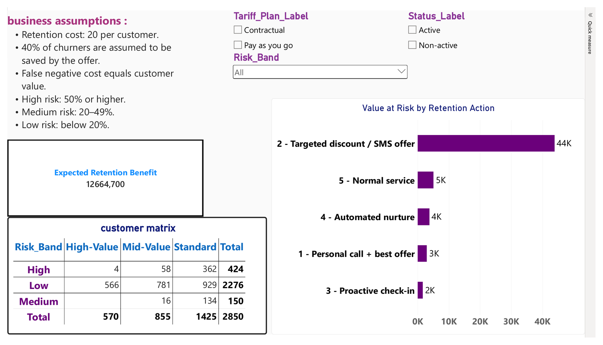
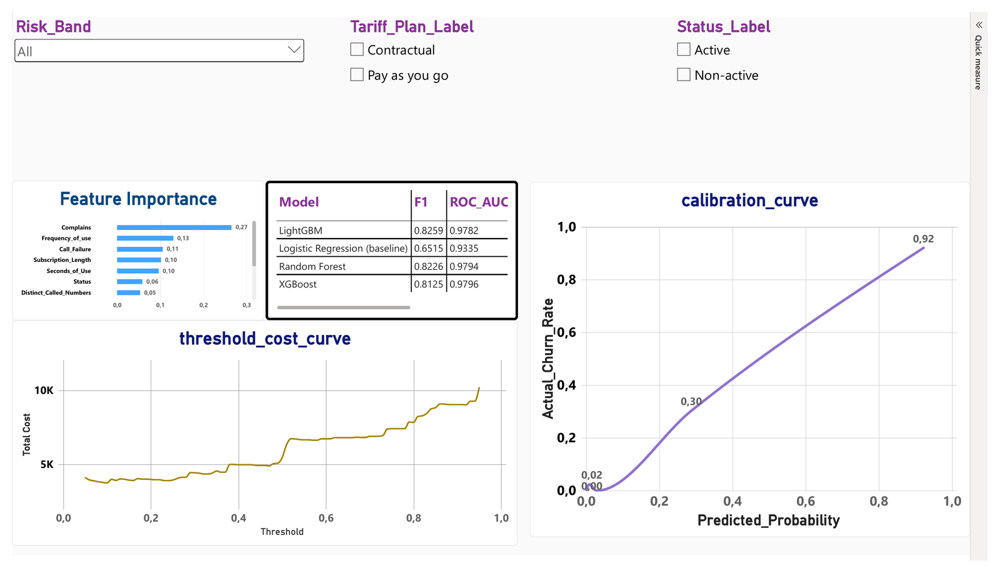

# Customer Churn Prediction: who will leave, and how much value is at risk

**Work done by: Malek Chourabi + Chayama Lessis**

End-to-end churn project for a telecom operator: data cleaning, exploratory analysis, leakage review, machine learning, SQL KPIs, a four-page Power BI dashboard and a retention plan.



## 1. Business problem

A telecom operator loses customers every period. The goal is not the most accurate model, but to help the retention team decide **which customers to contact, who should receive an offer, how much revenue is at risk, and how aggressively to intervene**.

## 2. Objectives

1. Explore the data and understand what drives churn.
2. Predict each customer's churn probability with a calibrated model.
3. Estimate value at risk = churn probability x customer value.
4. Choose the contact threshold from business costs, not from the default 0.5.
5. Give every customer a retention action and a priority rank.

## 3. Dataset

Iranian Churn Dataset, UCI Machine Learning Repository (CC BY 4.0): 3,150 customers of an Iranian telecom company. Inputs summarize the first 9 months of activity; churn is observed after a 3-month planning gap. See [`data/README.md`](data/README.md) for the data dictionary.

## 4. Tools

Python (pandas, scikit-learn, XGBoost, LightGBM, matplotlib), SQL (SQLite), Power BI Desktop, Jupyter.

## 5. Data cleaning

- 3,150 raw rows, no missing values, **300 duplicate rows removed -> 2,850 unique customers**.
- Customer ID and readable labels added; subscription length grouped into bands.
- 12 model inputs kept (`Age_Group` dropped, it repeats `Age`). Binary and ordinal codes stay numeric; only Logistic Regression is scaled.
- Leakage review: every feature is a 9-month summary available at prediction time. `Complains` and `Status` are rated Medium risk and must be confirmed with the business.

## 6. Exploratory findings

| Segment | Churn rate |
|---|---|
| Complaint filed / no complaint | 82.6% / 9.8% |
| Non-active / active | 47.5% / 5.6% |
| Pay as you go / contractual | 16.8% / 2.6% |
| First 12 months of subscription | 39.4% |
| 0-500 seconds of use / above 5,000 | 48.0% / 3.6% |

Heavy users are outliers but real customers with 0% churn, so outliers were kept. Call failures alone do not separate leavers from stayers.

## 7. Models and evaluation

Stratified 75/25 split, class weights for the 15.6% churn imbalance. Results on the test set at the **default threshold 0.5**:

| Model | Precision | Recall | F1 | ROC-AUC | PR-AUC |
|---|---|---|---|---|---|
| Logistic Regression (baseline) | 0.5128 | 0.8929 | 0.6515 | 0.9335 | 0.7755 |
| Random Forest | 0.7500 | 0.9107 | 0.8226 | 0.9794 | 0.9071 |
| XGBoost | 0.7222 | 0.9286 | 0.8125 | 0.9796 | 0.9197 |
| **LightGBM (selected)** | 0.7556 | 0.9107 | **0.8259** | 0.9782 | **0.9260** |

LightGBM is selected for the best PR-AUC and a strong F1, then calibrated with 5-fold isotonic calibration (Brier score 0.0424 -> 0.0348). Top drivers: complaints (0.27), frequency of use (0.13), call failures (0.11), subscription length (0.10), seconds of use (0.10).

### Key results

| Metric | Result | Note |
|---|---|---|
| Unique customers | 2,850 | |
| Churn rate | 15.6% | 446 churned customers |
| F1-score (LightGBM) | 0.8259 | default threshold 0.5, raw scores |
| PR-AUC (LightGBM) | 0.926 | default threshold 0.5, raw scores |
| Cost-optimal threshold | 0.10 | on calibrated probabilities |
| Recall at cost-optimal threshold | 97% | 109 of 112 churners caught; 56 false alarms (test set) |
| Value at risk | 57.3K | probability x customer value, all customers |
| High-risk customers | 424 | hold 46.8K (82%) of the value at risk |
| Customers worth contacting | 315 | positive expected retention benefit |

> The model comparison table uses the default threshold of 0.5 on raw scores. The recall of 97% uses the cost-optimal threshold of 0.10 on calibrated probabilities. Both are correct.

## 8. SQL analysis

15 queries on the scored table (churn by segment, risk bands, retention action plan, top customers to contact, data-quality checks). See [`sql/README.md`](sql/README.md).

## 9. Power BI dashboard

Four pages with filters for risk band, tariff plan and status. Open `powerbi/Customer_Churn_Dashboard.pbix`, or view `powerbi/dashboard_preview.pdf`.

| | |
|---|---|
|  |  |
|  | |

## 10. Business recommendations

| Segment | Action | Priority |
|---|---|---|
| High risk and High-Value (4) | Personal call + best offer | Immediate |
| High risk, other tiers (420) | Targeted discount / SMS offer, tested against a control group | This week |
| Medium risk, Mid/High value (16) | Proactive check-in | This month |
| Medium risk, Standard value (134) | Automated nurture messages | Automated |
| Low risk (2,276) | Normal service, no contact | None |

Also: treat every complaint as a retention case, follow up with new customers during the first 12 months, offer pay-as-you-go customers a contract plan, and trigger a message when usage drops.

**Limits:** customer value has no currency; the retention cost (20) and save rate (40%) are assumptions to be tested with a control group; scores are out-of-fold on the same customers, so a test on a future period is the real proof.

## 11. How to run

```bash
pip install -r requirements.txt

# option A: notebooks (already executed, outputs are saved)
jupyter notebook notebooks/

# option B: scripts, in this order
python python/data_preprocessing.py     # clean data -> data/processed/churn_clean.csv
python python/exploratory_analysis.py   # EDA, outliers, leakage review -> results/
python python/model_training.py         # four models -> results/model_comparison.csv
python python/model_evaluation.py       # threshold, calibration, importance -> results/
python python/customer_scoring.py       # scoring -> churn_scored.csv, risk segments, recommendations
python sql/create_database.py           # SQLite database and the 15 SQL queries
```

All random seeds are fixed, so the scripts reproduce the figures above (calibrated LightGBM, cost-based threshold 0.10).

## 12. Repository structure

```
data/         raw, cleaned and scored datasets + data dictionary
notebooks/    01 cleaning + EDA, 02 modeling, 03 customer risk analysis
python/       reusable scripts (preprocessing, EDA, training, evaluation, scoring)
sql/          15 queries, SQLite database, build script
powerbi/      PBIX dashboard + PDF preview
results/      model comparison, feature importance, threshold cost, calibration, risk segments, recommendations
reports/      full project report + executive summary
screenshots/  the four dashboard pages
```
